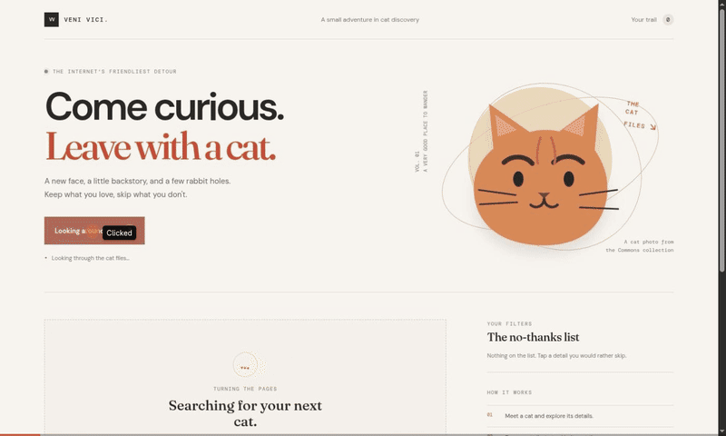

# Web Development Project 4 - *Veni Vici!*

Submitted by: **Juan Castillo**

This web app: **is a cat discovery club. Meet one cat at a time, learn about its breed, origin, and temperament, ban the details you want to skip, and revisit every cat from your session.**

Time spent: **To be confirmed by Juan** hours spent in total

## Required Features

The following **required** functionality is completed:

- [x] **The app can call an API and display an item**
  - Discover makes a new asynchronous request to The Cat API.
  - The response is parsed and normalized before it enters React state.
- [x] **The displayed item includes a matching image and at least three consistent attributes**
  - One current cat appears at a time with breed, origin, and temperament.
  - Images come from the same Cat API record as the selected breed metadata.
- [x] **The user can ban attributes and remove them from the ban list**
  - Breed, origin, and temperament are clickable.
  - Selecting an attribute adds it to the visible no-thanks list.
  - Selecting a list item removes that ban; Clear all removes every ban.
- [x] **Future results that match banned values are skipped**
  - Each discovery checks a batch of results and fetches another batch when needed.
  - Already-seen image IDs are skipped so repeats are less frequent.
- [x] **The app shows one current result and provides loading, error, and no-match feedback**

The following **optional** features are implemented:

- [x] Multiple attribute types can be added to the ban list.
- [x] Previously viewed cats are stored in session state and shown in a dedicated history section.
- [x] Each history item includes its own image and the same three attributes.

The following **additional** features are implemented:

- [x] Filters apply to breed identity, origin, and the first displayed temperament value.
- [x] Results are de-duplicated during the session and history is newest first.
- [x] Responsive layouts, keyboard focus indicators, image descriptions, live status feedback, and reduced-motion support.

## Video Walkthrough

**Walkthrough recording pending.** Replace this placeholder with a recorded GIF before submission.

## Notes

The app requests random, medium-sized images that have breed data from The Cat API. `src/lib/cats.js` normalizes the response to one stable shape. `App` owns the current cat, session history, ban list, and request state. A discovery checks up to four batches of 40 images, skips matching filters and already-seen IDs, and only then updates the current result and history. Breed, origin, and temperament filters are compared to the same values shown on the card.

The API's open image and breed endpoints are used without a private key. The API and its available records are external services, so network access is needed to discover cats. See [LEARNING.md](LEARNING.md) for setup and implementation details.

## License

    Copyright 2026 Juan Castillo

    Licensed under the Apache License, Version 2.0 (the "License");
    you may not use this file except in compliance with the License.
    You may obtain a copy of the License at

        http://www.apache.org/licenses/LICENSE-2.0

    Unless required by applicable law or agreed to in writing, software
    distributed under the License is distributed on an "AS IS" BASIS,
    WITHOUT WARRANTIES OR CONDITIONS OF ANY KIND, either express or implied.
    See the License for the specific language governing permissions and
    limitations under the License.
